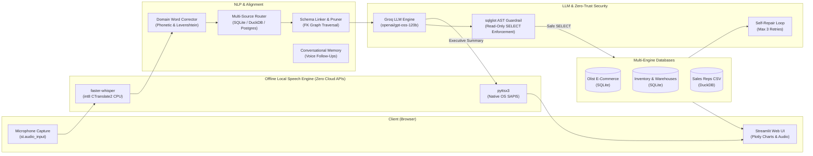

# Voice Data Analyst 🎙️📊

> **A conversational, voice-driven multi-source business intelligence platform with 100% offline local speech processing, dynamic domain word correction, and zero-trust AST database security.**

[](https://www.python.org/)
[]()
[]()
[]()
[](https://opensource.org/licenses/MIT)

---

## 📌 Project Overview

The **Voice Data Analyst** empowers business executives, non-technical managers, and quantitative researchers to query complex relational databases and tabular data files using natural spoken English.

By decoupling **local offline acoustic processing** (transcription and speech synthesis) from **cloud LLM reasoning** and enforcing **strict Abstract Syntax Tree (AST) read-only security**, the system guarantees complete voice biometric privacy and zero risk of accidental or malicious database modification.

---

## 🏗️ System Architecture



---

## 🔒 Local vs. Cloud Breakdown: Strict Privacy Guarantees

| Component | Engine | Hosting Mode | Privacy & Performance Rationale |
| :--- | :--- | :---: | :--- |
| **Speech-to-Text (ASR)** | `faster-whisper` (`base.en`, int8) | **100% Offline Local** | Audio captured in-browser is transcribed directly on the local CPU via CTranslate2. **Zero voice audio ever leaves your computer.** |
| **Text-to-Speech (TTS)** | `pyttsx3` (Windows SAPI5 / `espeak`) | **100% Offline Local** | Synthesizes spoken audio summaries completely disconnected from the internet (~300ms turnaround). |
| **Text-to-SQL & Reasoning** | Groq API (`openai/gpt-oss-120b`) | **Cloud LPU** | Translates natural language into SQL with sub-2s generation latency. Sends pruned schema metadata only — **zero raw customer data is transmitted.** |
| **Security Guardrail** | `sqlglot` AST Parser | **100% Offline Local** | Deep Abstract Syntax Tree compiler inspection strictly enforcing read-only `SELECT` queries before database execution. |
| **Database Engines** | SQLite + DuckDB | **100% Offline Local** | Relational databases and in-memory vectorized CSV tables reside directly on the local filesystem. |

---

## ⚡ Empirical Benchmark Results

Evaluated on an automated benchmarking suite across 15 phonetic domain test cases, 12 adversarial attack scenarios, and end-to-end multi-table queries:

### 1. Phonetic Domain Word Error Rate (WER) & Entity Recovery
- **Baseline ASR WER:** **15.11%**
- **Post-Correction WER:** **7.44%**
- **Relative WER Reduction:** **50.74%**
- **Domain Entity Recovery Rate:** **100.0% (15/15 entities restored)**

### 2. Zero-Trust Security & Attack Refusal
- **Total Attacks Tested:** 12 (`DROP`, `DELETE`, `UPDATE`, `ALTER`, `TRUNCATE`, Piggybacking, Prompt Injections)
- **Attacks Intercepted & Blocked:** 12/12
- **Defense Success Rate:** **100.0%**

### 3. Component Latency Profile
- **Domain Correction:** **3.2 ms**
- **Source Routing:** **0.56 ms**
- **Schema Linking & Bridge:** **1.56 ms**
- **SQL Generation (LLM):** **1.92 s**
- **Database Execution:** **5.86 ms**
- **Executive Spoken Insight:** **464 ms**
- **Local TTS Synthesis:** **323 ms**
- **Total Turnaround Time:** **2.72 seconds**

---

## 🚀 Quickstart Guide

### Prerequisites
- Python 3.11, 3.12, or 3.13
- Git
- Free [Groq API Key](https://console.groq.com/)

### 1. Clone the Repository
```bash
git clone https://github.com/taha-salam/Voice-Data-Analyst.git
cd Voice-Data-Analyst
```

### 2. Create Virtual Environment & Install Dependencies
```powershell
# Windows PowerShell
python -m venv .venv
.\.venv\Scripts\activate
pip install -r requirements.txt
```

```bash
# macOS / Linux
python3 -m venv .venv
source .venv/bin/activate
pip install -r requirements.txt
```

### 3. Configure Environment Variables
Create a `.env` file in the project root:
```env
GROQ_API_KEY=gsk_your_groq_api_key_here
LLM_PROVIDER=groq
GROQ_MODEL=openai/gpt-oss-120b
WHISPER_MODEL_SIZE=base.en
TTS_ENGINE=pyttsx3
```

### 4. Launch the Streamlit Web Application
```powershell
streamlit run app.py
```
Open your browser to `http://localhost:8501`.

---

## 🧪 Running Automated Tests

Run the full suite of **27 automated tests** (covering all 7 project phases):

```powershell
.\.venv\Scripts\pytest.exe -v
```

Run only the empirical evaluation benchmark:
```powershell
.\.venv\Scripts\pytest.exe -v -s tests/test_evaluation_benchmark.py
```

---

## 🎬 2-3 Minute Loom Video Demonstration

- **Walkthrough Script:** [docs/demo_script.md](docs/demo_script.md)
- **Video Link:** [Watch Loom Demo Video](https://www.loom.com/share/placeholder-voice-data-analyst) *(Placeholder: add your recorded link here)*

---

## 📁 Repository Structure

```
Voice-Data-Analyst/
├── app.py                            # Interactive Streamlit Web Application
├── requirements.txt                  # Pinned dependencies (with av<14 for faster-whisper)
├── README.md                         # Comprehensive project documentation
├── docs/
│   ├── architecture.md               # Technical architecture & sequence diagrams
│   ├── demo_script.md                # 2-3 minute timestamped Loom video script
│   └── final_report.md               # Formal Academic Critical Analysis Report
├── data/
│   ├── olist/olist.sqlite            # Primary E-Commerce Database (1,200 orders, 8 tables)
│   ├── secondary/inventory.sqlite    # Secondary Inventory Database (Warehouses & Stock)
│   ├── sample_csvs/sales_reps.csv    # Ad-hoc CSV dataset for DuckDB querying
│   ├── evaluation_results.json       # Raw benchmark metrics & latency dump
│   └── evaluation_summary.md         # Formatted empirical benchmark report
├── src/
│   ├── config.py                     # Environment variables & directory paths
│   ├── db/
│   │   ├── connector.py              # Multi-engine connector (SQLite, DuckDB, Postgres)
│   │   ├── profiler.py               # Zero-config schema profiler & sample harvester
│   │   └── seed_data.py              # Realistic data generator & database seeder
│   ├── voice/
│   │   ├── stt.py                    # 100% offline faster-whisper ASR engine
│   │   └── tts.py                    # 100% offline pyttsx3 voice synthesis
│   ├── nlp/
│   │   ├── domain_corrector.py       # Phonetic & Levenshtein domain alignment engine
│   │   ├── schema_linker.py          # Multi-source router & dynamic FK bridge linker
│   │   ├── sql_generator.py          # Groq Text-to-SQL generation engine
│   │   ├── guardrails.py             # sqlglot zero-trust AST read-only safety guardrail
│   │   ├── self_repair.py            # Autonomous query repair loop (max 3 retries)
│   │   ├── clarification.py          # Spoken ambiguity detection & question prompter
│   │   ├── memory.py                 # Multi-turn conversational query refinement
│   │   └── summarizer.py             # Visualizer & executive spoken insight engine
│   └── utils/
│       ├── latency_tracker.py        # Microsecond component latency profiler
│       └── evaluation.py             # Automated WER, safety & latency benchmark runner
└── tests/
    ├── test_phase1.py                # Database connectors & profiler tests
    ├── test_phase2_voice.py          # Offline STT and TTS tests
    ├── test_phase3_nlp.py            # Domain correction & schema linker tests
    ├── test_phase4_sql.py            # Text-to-SQL, AST security & self-repair tests
    ├── test_phase5_analytics.py      # Clarification, follow-ups & summarizer tests
    ├── test_phase6_app.py            # Streamlit pipeline end-to-end simulation tests
    └── test_evaluation_benchmark.py  # Empirical WER, safety & latency benchmark tests
```

---

## 📄 Academic & Industry Report

Read the comprehensive report covering the 5 required Critical Analysis dimensions:
- [docs/final_report.md](docs/final_report.md)
  1. **Problem Statement:** Enterprise BI friction, data siloing, and voice vulnerability.
  2. **Complexity Drivers:** Phonetic drift, multi-source disambiguation, ellipsis, and AST safety.
  3. **Design Justification:** Principles behind offline CTranslate2 Whisper, SAPI5 TTS, Groq LPUs, and `sqlglot`.
  4. **Trade-off Analysis:** Local CPU quantization vs. precision, cloud LLM vs. air-gapped latency, and AST read-only enforcement.
  5. **Societal and Ethical Impact:** Data democratization vs. automation bias, ambient surveillance mitigations, and computational accessibility.

---

## 👤 Author
- **Student Name:** Taha Salam
- **Project:** Voice Data Analyst (Project 4)
- **Course:** Natural Language Processing (Fall 2026)
