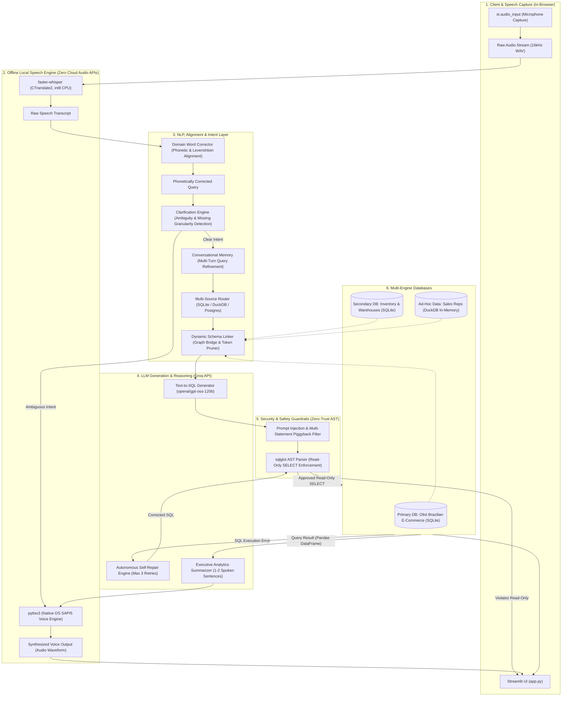
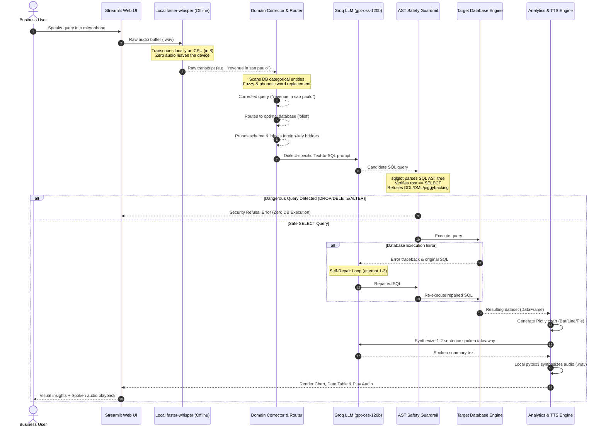

# Voice Data Analyst — System Architecture & Data Flow

## 1. High-Level Architecture Overview

The **Voice Data Analyst** is an end-to-end conversational business intelligence system. It combines offline local acoustic modeling with cloud LLM reasoning and zero-trust AST database security to allow non-technical business stakeholders to query multi-engine databases using spoken natural English.

---

## 2. End-to-End Execution Sequence

---

## 3. Component Details & Privacy Guarantees

### A. 100% Offline Local Speech Processing
- **Automatic Speech Recognition (ASR):** Powered by `faster-whisper` (`base.en` model with `int8` CTranslate2 quantization). Runs strictly on the local CPU without external HTTP calls. Audio captures are converted directly in RAM to PCM 16kHz monochannel arrays.
- **Text-to-Speech (TTS):** Powered by `pyttsx3` using Windows native SAPI5 voices (David / Zira) or Linux `espeak`. Operates fully disconnected from the internet, completely eliminating voice biometric leakage and ensuring compliance with healthcare and enterprise data privacy regulations.

### B. Dynamic Zero-Config Schema Profiling & Pruning
- Rather than dumping the entire schema into the LLM context, `DatabaseProfiler` extracts table schemas, primary keys, foreign keys, row counts, and distinct sample values on startup.
- `SchemaLinker` dynamically scores tables against user query tokens, retains only the top relevant tables, and traverses the foreign key graph to inject necessary join bridging tables (e.g., connecting `customers` to `order_items` via `orders`).

### C. Phonetic Domain Word Correction
- Speech recognition models frequently mishear specialized foreign nouns, Brazilian cities, and product categories (e.g., "san paulo" for "sao paulo", "bell horizonte" for "belo horizonte", "curitibia" for "curitiba").
- `DomainWordCorrector` dynamically harvests distinct entity values across active databases and performs a two-stage alignment:
  1. Priority alias map for common dialectal phonetic variations.
  2. Multi-word n-gram fuzzy matching with Levenshtein token distance and word-boundary safety filters.

### D. Zero-Trust AST Security Guardrail
- Natural language to SQL models are vulnerable to prompt injections, destructive data modifications, and privilege escalations.
- `SafetyGuardrail` parses the generated SQL into an Abstract Syntax Tree (AST) using `sqlglot`. It enforces that:
  - The root node must be an explicit `SELECT` or `UNION`.
  - Disallowed statement nodes (`Drop`, `Delete`, `Update`, `Insert`, `Create`, `Alter`, `TruncateTable`, `Command`, `Pragma`) are rejected before touching the database connection.
  - Multi-query piggybacking (queries with semicolons followed by secondary commands) is strictly prohibited.
